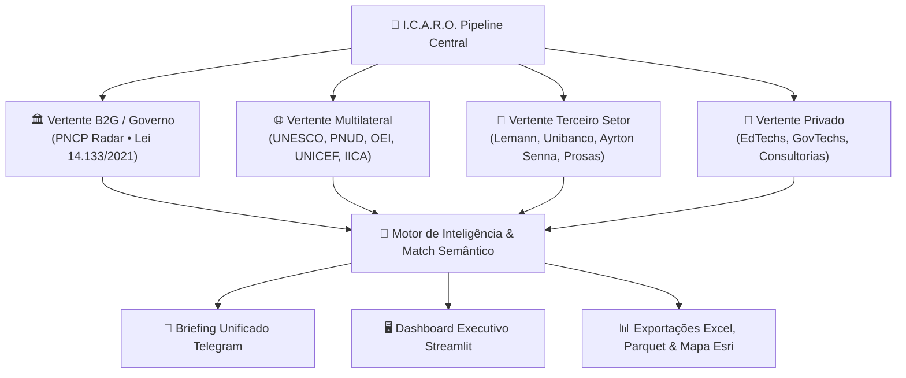

# 🦅 I.C.A.R.O. — Inteligência de Captura e Análise de Recrutamentos e Oportunidades

> **Plataforma unificada de inteligência artificial, raspagem autônoma e DataViz executivo para monitoramento contínuo de compras públicas (B2G), agências internacionais, terceiro setor e mercado privado.**

---

## 🌟 Visão Geral

O **I.C.A.R.O.** é um ecossistema autônomo projetado para capturar, qualificar semanticamente e priorizar oportunidades de alto valor em consultorias, termos de cooperação, contratações públicas e posições de liderança estratégica.

O sistema atua com foco prioritário na interseção entre **Educação Pública, Inteligência Artificial, Ciência de Dados, Avaliação Educacional (IDEB/SAEB/ENEM), Robótica/Pensamento Computacional (BNCC) e Governança de Políticas Públicas**.



---

## 📑 Verticais Monitoradas

### 1. 🏛️ Compras Públicas & Governo (PNCP Radar)
- **Fonte Central:** Portal Nacional de Contratações Públicas (PNCP), cobrindo Compras.gov.br, Licitar Digital, BLL, IPM Sistemas, Portais Estaduais e Municipais.
- **Motor de Busca Indexada:** Consulta em tempo real via `/api/search/` em títulos, termos de referência e itens de contratação.
- **Scoring Multidimensional (0 a 100):** Avalia Histórico da Modalidade, Aderência Técnica, Custo-Benefício (Ticket Sweet Spot) e Logística Operacional (9 Bases Estratégicas e raio de 250 km).
- **Anti-Ruído:** Blacklist severa descartando falsos positivos (obras pesadas, alimentação, exames de medicina do trabalho).

### 2. 🌐 Agências Internacionais & Multilaterais
- **Fontes Monitoradas:** UNESCO, PNUD (UNDP Global e Brasil), OEI (Organização dos Estados Ibero-Americanos), UNFPA, UNICEF e IICA.
- **Foco:** Termos de Referência (TRs) para consultorias individuais por produto, gestão de evidências no MEC/INEP e projetos de cooperação internacional (PRODOCs).

### 3. 🤝 Terceiro Setor & Fundações
- **Fontes Monitoradas:** Fundação Lemann, Instituto Unibanco, Fundação Telefônica Vivo, Instituto Ayrton Senna, Itaú Social e editais do Prosas.
- **Foco:** Chamadas de fomento, bolsas de pesquisa aplicada, gestão educacional e formação continuada.

### 4. 💼 Mercado Privado, EdTechs & GovTechs
- **Fontes Monitoradas:** Cogna, SOMOS Educação, Arco, Geekie, Descomplica, Alura, Portabilis, Evolucional, TOTVS, EloGroup, Falconi e Macroplan.
- **Foco:** Posições executivas e de assessoria técnica sênior em produtos educacionais e dados.

---

## 🤖 Análise Semântica por Inteligência Artificial (Google Gemini)

O motor utiliza a API REST do **Google Gemini** com chave rotativa e fallback de alta disponibilidade (`gemini-2.5-flash`, `gemini-2.0-flash`, `gemini-1.5-flash`) para avaliar cada edital frente ao perfil executivo do candidato.

A IA extrai estruturadamente:
- **Cargo / Objeto:** Escopo resumido da oportunidade.
- **Requisitos & Localização:** Remoto, Híbrido ou Presencial (com verificação de proximidade das bases logísticas).
- **Contrato & Remuneração:** Valor global, por produto ou vigência.
- **Grau de Aderência:** Classificação rigorosa em `Alta`, `Média` ou `Baixa`.
- **Parecer Sintético:** Justificativa técnica destacando diferenciais e pontos de atenção.

---

## 🚀 Como Executar o Sistema

### 1. Preparação do Ambiente

```bash
# Clone o repositório
git clone https://github.com/guimaraesca/pncp-radar.git
cd pncp-radar

# Crie e ative o ambiente virtual
python3 -m venv venv
source venv/bin/activate

# Instale as dependências
pip install -r requirements.txt
```

### 2. Configuração de Variáveis de Ambiente (`.env`)

Crie ou edite o arquivo `.env` na raiz do projeto:

```env
# Inteligência Artificial (Google Gemini)
GEMINI_API_KEY=sua_chave_gemini_aqui

# Notificações Executivas via Telegram Bot (Opcional)
TELEGRAM_TOKEN=seu_bot_token_aqui
TELEGRAM_CHAT_ID=seu_chat_id_aqui
```

---

## 🛠️ Modos de Execução (CLI Unificado)

O sistema possui um ponto de entrada unificado através do script [`run_icaro.py`](run_icaro.py):

| Comando | Finalidade |
| :--- | :--- |
| `python run_icaro.py` | **Execução Completa Integrada:** Varre o PNCP, aciona os scrapers de agências e fundações, analisa com IA, reexporta artefatos e envia o **Briefing Unificado no Telegram**. |
| `python run_icaro.py --mode pncp` | Executa exclusivamente o pipeline de Compras Públicas (PNCP Radar). |
| `python run_icaro.py --mode scrapers` | Executa os scrapers de agências internacionais, fundações e mercado privado. |
| `python run_icaro.py --mode export` | Reexporta as planilhas Excel multi-abas, Parquet e o Mapa Interativo Esri. |
| `python run_icaro.py --mode dashboard` | Inicializa o painel web interativo do Streamlit. |

---

## 🖥️ Painel Interativo Streamlit

Para iniciar o dashboard executivo em tela cheia:

```bash
streamlit run pncp_intelligence/dashboard/app.py
```

O dashboard estará disponível em `http://localhost:8501`, organizado em 5 módulos:
1. **📊 1. Visão Geral (Command Center PNCP):** Fluxo tático com diagramas Sankey, linha do tempo WSJ Swarm e cards executivos com links oficiais.
2. **🧠 2. Contexto Temático:** Análise Quali-Quanti (Sharpe Gov), TAM e sazonalidade de contratações.
3. **🔍 3. Detalhes:** Explorador granular de itens unitários e valores homologados.
4. **🛡️ 4. Observabilidade:** Monitoramento dos 5 pilares de dados (Freshness, Volume, Distribution, Schema e Lineage).
5. **🦅 5. Central I.C.A.R.O.:** Oportunidades qualificadas de agências internacionais (UNESCO, PNUD, OEI), terceiro setor e privado com parecer semântico da IA e botão de inscrição.

---

## 📱 Notificação Unificada no Telegram

Ao final de cada ciclo, o I.C.A.R.O. envia **uma única mensagem longa, formatada e detalhada** para o seu Telegram:

- **🏛️ Seção 1 (PNCP):** Top editais abertos com Score $\ge$ 75, valor total, dias restantes, modalidade e link oficial no portal.
- **🌐 Seção 2 (I.C.A.R.O.):** Chamadas de alta e média aderência de agências e fundações com parecer da IA, remuneração e link direto.
- **Sem Spam:** Mensagens vazias ou avisos intermediários foram eliminados.

---

## 🛡️ Observabilidade e Governança de Dados

O pipeline implementa governança ativa conforme a Lei 14.133/2021:
- **Freshness:** Verificação contínua da defasagem em relação à API do PNCP.
- **Volume:** Monitoramento de taxas de descarte e integridade de itens.
- **Distribution:** Detecção de outliers de valor e anomalias de prazos.
- **Schema:** Conformidade com o contrato canônico de dados da API.
- **Lineage:** Rastreabilidade criptográfica (hash SHA-256) das regras semânticas vigentes.

---

## 📄 Licença

Uso proprietário e estratégico — **Carlos Artur Guimarães & Felipe Souza**. Todos os direitos reservados.
